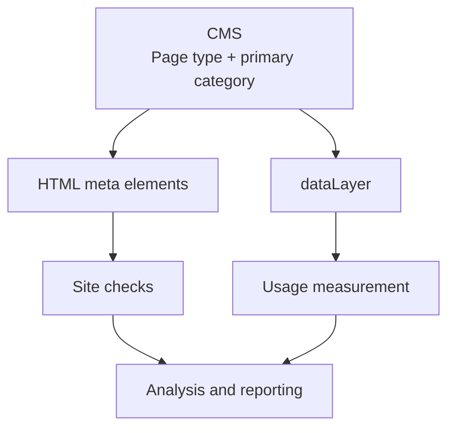

An analytics report shows page URLs, titles and view counts. It does not tell you what kind of page it was, what topic it covered or what the page was meant to achieve. Yet that is what an organisation needs, because it looks at its website as services, topics and goals, not as URLs.

In a city's analytics report, applying for a daycare place, building permits, autumn holiday events and waste sorting guides can sit side by side. They are all measured as pages, even though their jobs are completely different.

If every page ends up in the same average, the report says little about how the different parts of the site are used. A list of individual page URLs, on the other hand, can run to thousands of rows.

You can make the overall picture clearer by giving every page two basic pieces of information: **what kind of page it is and which primary category it belongs to.** They add what the URL does not tell you. The report can then show understandable groups, and a single page can be compared with similar pages.

## Page type tells what kind of page it is. Primary category tells what it is about.

**Page type answers the question: what kind of page is this?** On a city website a page can be, for example, a service, an event, a guide or a news item. Page type often also tells the purpose of the page: a service page leads to a transaction, a guide answers a question and an event page tells what is coming up.

**Primary category answers the question: what is this page primarily about?** The topic can be, for example, early childhood education, housing and construction, culture and leisure, or the environment.

In practice the difference looks like this:

| Page | Page type | Primary category |
|---|---|---|
| Applying for a daycare place | Service | Early childhood education |
| Applying for a building permit | Service | Housing and construction |
| Autumn holiday events | Event | Culture and leisure |
| Sorting household waste | Guide | Environment |

Applying for a daycare place and applying for a building permit are both service pages, even though they cover different topics. The early childhood education topic can include guides, news and events as well as services.

So page type and primary category are not alternatives. Every page gets both. With two separate pieces of information, a report can show pages of the same type and content on the same topic.

<figure>


  <figcaption>Image generated with AI.</figcaption>
</figure>

In the technical implementation, the page type field can be called `page_type` and the primary category field `primary_category`. When producing content, it is enough to understand the concepts and pick the right options for the page.

## How classification gives the report context

Imagine a city website with 100,000 page views a month. A page view means one view of a page; the same person can generate several. The following numbers are fictional and cover the same month.

With classification, the same data can be viewed in five ways:

| View | What is selected for the report? | Page views |
|---|---|---:|
| Whole site | All city pages | 100,000 |
| Page type | All service pages, regardless of topic | 40,000 |
| Primary category | All early childhood education pages, regardless of page type | 20,000 |
| Page type + primary category | Early childhood education service pages | 12,000 |
| Single page | Applying for a daycare place | 3,600 |

The rows are partly overlapping views of the same data, so the numbers are not added together.

In the table, the data narrows from the whole site to an ever more specific comparison group:

**whole site → page type or primary category → page type + primary category → single page**

The number for the whole site tells the total amount of use, but not which content is used. Page type and primary category each narrow the data in their own way. With page type you can look at all service pages, for example. With primary category, the person responsible for a topic sees the use of their own area.

When the selections are combined, applying for a daycare place gets a comparison group of pages that have both a similar job and a shared topic. The single page can then be looked at within this group.

When the report is narrowed to service pages whose primary category is early childhood education, four pages remain. The 12,000 views of the fictional example would be split between them like this:

<table>
  <thead>
    <tr><th>Page</th><th style="text-align: right">Page views</th><th style="text-align: right">Share of group</th></tr>
  </thead>
  <tbody>
    <tr><td>Pre-school registration</td><td style="text-align: right">4,200</td><td style="text-align: right">35%</td></tr>
    <tr><td><strong>Applying for a daycare place</strong></td><td style="text-align: right"><strong>3,600</strong></td><td style="text-align: right"><strong>30%</strong></td></tr>
    <tr><td>School enrolment</td><td style="text-align: right">2,900</td><td style="text-align: right">24%</td></tr>
    <tr><td>Applying for school transport</td><td style="text-align: right">1,300</td><td style="text-align: right">11%</td></tr>
  </tbody>
  <tfoot>
    <tr><td>Total</td><td style="text-align: right">12,000</td><td style="text-align: right">100%</td></tr>
  </tfoot>
</table>

The number 3,600 alone does not say much. In the group you can see that applying for a daycare place is the second most viewed service, with almost a third of the views.

Now you can compare applying for a daycare place with the other pages in its group. If the views change, you can find out whether the other pages show a similar change or whether it only affects this service.

## A change rarely affects the whole site

When the total number drops, it looks as if the whole site is losing visitors. Usually the change is concentrated in a small part of the site.

Imagine that the city website's monthly page views fall by 15 percent. The report shows a falling line and a list of thousands of URLs. When the same views are split by page type, the picture changes:

| Page type | Page views before | Page views after | Change |
|---|---:|---:|---:|
| Service | 40,000 | 39,000 | −2.5% |
| Guide | 30,000 | 16,000 | −47% |
| News | 15,000 | 15,000 | 0% |
| Event | 15,000 | 15,000 | 0% |
| **Whole site** | **100,000** | **85,000** | **−15%** |

The numbers are fictional.

Almost the whole drop comes from guide pages. Services, news and events are viewed almost as much as before. **The drop came from one page type.**

That leaves a limited set of pages to review. Primary category narrows the set further: does the drop affect all guides, or only environment guides, for example?

The same classification also helps when you plan content as topic clusters. A topic cluster is one broad main page and the supporting pages that answer narrower questions. In city early childhood education it could be an overview plus the application pages for daycare, pre-school and school transport.

A plan does not yet tell you whether the cluster works. You can see it when every page has a primary category. All early childhood education pages form one group in the report. Page type separates the overview from the supporting pages.

This helps when AI answers reduce clicks. The line for the whole site does not tell which topic is losing views. In a report grouped by primary category you can see whether one cluster is falling or the whole site.

## A comparison group helps you find the question, not yet the answer

The smaller view count of the school transport application page does not by itself mean that the page works poorly. A smaller group of people may need the service. The pre-school registration period can explain the larger view count of that page.

Classification helps you spot differences and choose what is worth investigating. The reason for a difference is found separately. Even within the same group, pages can have different numbers of users, deadlines and ways of handling the task.

A page's success is judged by its goal. On the daycare service page you can find out, for example, whether visitors find their way to the application. A reader of a sorting guide can get the answer straight from the page. The view count alone answers neither question, and studying the move to the application also needs a measurement that describes it.

**Classification gives the numbers a context for comparison. By itself it does not tell why content works the way it does.**

## What do I choose when I publish a page?

Once classification is in use, publishing the page about applying for a daycare place should look roughly like this:

<dl class="classification-example">
  <div class="classification-row">
    <dt class="classification-label">Page type</dt>
    <dd class="classification-value">Service</dd>
  </div>
  <div class="classification-row">
    <dt class="classification-label">Primary category</dt>
    <dd class="classification-value">Early childhood education</dd>
  </div>
</dl>

You pick the right options from ready-made lists. If the page type can be reliably deduced from the site structure or content type, the system can set it automatically. In other cases you choose the page type yourself.

These choices belong to the same publishing work as checking the title, the links and the content. The website's job is to store the information and pass it on to the agreed tools. The content producer does not need to know the settings of measurement tools or move classifications to reports by hand.

### One page has one primary category

A page can cover several things, but at this level of reporting it belongs to one primary category. Choose the topic by what the page primarily helps people do or understand.

The daycare application page may also mention a family moving to a new area. The primary category is still **Early childhood education**, because applying for a daycare place belongs primarily to that topic. Mentioning moving does not make it a housing service page.

If the choice is unclear, use the shared classification guidelines or ask the person responsible for the content. Agree a separate rule for the front page and other general pages.

On a multilingual site, the primary category can be inherited by the language versions, so the same content does not need to be classified many times.

### Ready-made options keep the report together

If the primary category is written in a free text field, the same concept can end up in the system as "Education", "education", "Teaching" and "Early childhood education". When these arrive as separate values, the numbers of one topic are scattered across different groups in the report.

In a ready-made list everyone gets the same option. Agree new primary categories together if the current options are not enough.

There should be so few options that a content producer can choose without opening the classification guide every time. If the options start to number in the dozens, check whether the classification has become too detailed. The goal is a classification that people understand and can use consistently.

## The same model works on other sites

On a city website the model separates, for example, a service from its topic. On other sites, similar pairs could look like this:

| Site | Page type | Primary category |
|---|---|---|
| Online store | Product | Lamps |
| B2B company | Case study | Security |
| Non-profit | Guide | Volunteering |

The questions stay the same: what kind of page is this and what is it primarily about?

## Define once and use the same information in different tools

The site needs a place to store classifications and a way to pass them on. This can require development work. A developer and the person responsible for analytics implement it and check it.

The content management system, or CMS, stores the choices and is the source of the classifications. Other systems use the same information. The classification can be published, for example, in the page's own HTML meta elements. They hold machine-readable information in the page's code:

<div data-no-copy>

```html
<meta name="page_type" content="service">
<meta name="primary_category" content="education">
```

</div>

Here the agreed identifiers `service` and `education` correspond to the choices Service and Early childhood education. The options can be shown to the content producer in their own language. The field names are the site's own definitions, and browsers and search engines do not know them in advance.

To pass information to analytics tools, you can use a shared data structure called the [dataLayer](https://developers.google.com/tag-platform/tag-manager/datalayer). Below, the classification travels from the CMS to two uses: site checks and usage measurement. The information from both can be used in analysis and reporting.



The connections in the diagram have to be implemented on the site: metadata does not move into analytics by itself. The content producer only needs to choose the page type and primary category once.

A tool that crawls the site automatically, such as [Screaming Frog](https://www.screamingfrog.co.uk/seo-spider/tutorials/web-scraping/), can be set up to extract this metadata. The check finds, for example, pages missing a page type or primary category, values that should no longer be used, and different spellings of the same value, such as `education` and `Education`. The same data can also be used, for example, to compare the headings of different topics.

It is worth monitoring classification coverage already in the content management system. The content list can show, for example, the unclassified pages. The crawling tool complements this by checking the values that were finally published on the site: the CMS tells what the pages should have, and the check tells what the site has.

**Define the classification once and reuse it.** The same information supports content management, analytics, reporting and the site's technical checks.

## Two choices as part of continuous publishing work

You can start classification with a limited set of content, for example the early childhood education service pages. They can be used to test whether the options are clear and whether the grouping helps reporting. Older content can be classified in agreed batches.

From then on, every new page is classified when it is published. When the purpose of a page changes, its classification is checked too. Give the shared option lists an owner, and record changes to the categories so you can interpret how the reports develop over time.

When classification is part of normal publishing work, you do not have to build the same groups by hand later for reporting. You know two things about every page: **what kind of page it is and what its primary category is.**
